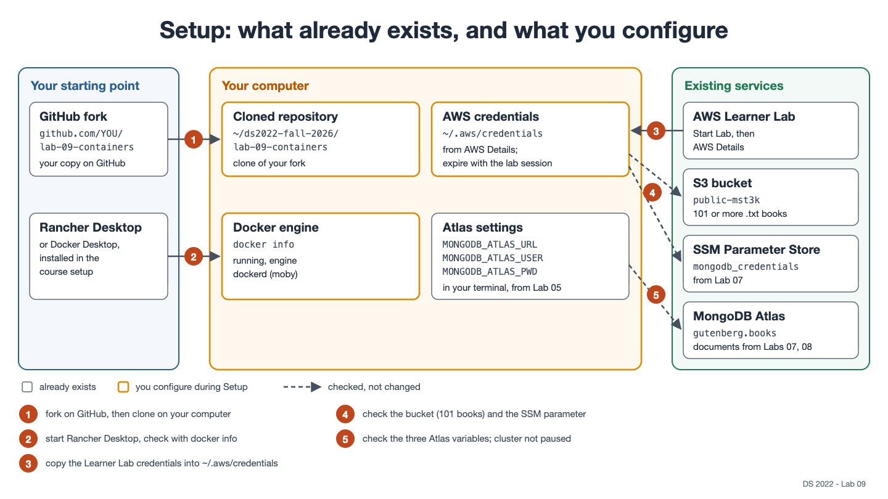

# Lab 09: Package the Book Analysis as a Container Image

> [!CAUTION]
> **Do NOT click Reset in the AWS Academy Learner Lab unless your instructor tells you to.**
> Reset permanently deletes everything in your lab account (S3 buckets, EC2 instances, Lambda functions, ...) and cannot be undone. To pause, click **End Lab** instead. Your resources will remain available the next time you click **Start Lab**.

In this lab you package the book analysis from [Lab 07](https://github.com/ksiller/lab-07-ec2-lambda) as a **container image**, together with Python and every package it needs, so that any computer with a container runtime can run exactly the same software. In Lab 07, every machine first had to install `uv` and run `uv sync`, and in Lab 08 the environment also depended on the cluster's modules. An image carries its software environment with it.

You write a `Dockerfile` for the Lab 07 uv project, build the image on your computer with Docker, as in [Class 09](https://github.com/ksiller/DS2022/blob/main/class/09-containers/README.md), and run `analyze.py` in a container on all your books. Optionally, you publish the image on the **GitHub Container Registry** (`ghcr.io`), from where other computers can pull it.

> [!IMPORTANT]
> `mst3k` is a placeholder. Replace it everywhere with your UVA computing ID, for example `public-mst3k` → `public-abc2de`. If your Lab 06 bucket has a different name, use that name. Likewise, replace `YOUR_USERNAME` with your GitHub user name, **in lowercase** wherever it is part of an image name.

## Learning goals

- Describe what an image, a container, and a registry are
- Write a `Dockerfile` for a Python uv project: base image, dependencies from the lock file, a non-root user, `ENTRYPOINT` and `CMD`
- Build an image, list it, and inspect its metadata (`docker build`, `docker images`, `docker inspect`)
- Run a container, follow it through its life cycle, and stop and remove it (`docker run`, `docker ps`, `docker logs`, `docker stop`, `docker rm`)
- Give a container access to AWS and MongoDB at run time, without putting credentials into the image
- Tell an image's tag from its ID and digest
- *Optional:* tag an image and push it to a registry

The lab builds on:

- [Lab 06: Working with S3](https://github.com/ksiller/lab-06-s3): your bucket holds the books
- [Lab 07: EC2 and Lambda](https://github.com/ksiller/lab-07-ec2-lambda): the code you package, and the SSM parameter `mongodb_credentials`
- [Lab 08: HPC](https://github.com/ksiller/lab-08-hpc): the `llm_analysis` fields in your documents
- [Class 09: Containers](https://github.com/ksiller/DS2022/blob/main/class/09-containers/README.md): Part 2 (`my_image`: building images and new versions, `ENTRYPOINT` and `CMD`, and mounting a directory)

## What is in this repository

```text
lab-09-containers/
├── README.md
├── pyproject.toml              # uv project from Lab 07: boto3, pymongo
├── uv.lock
├── .python-version
├── src/book_analysis/
│   ├── analyze.py              # the Lab 07 analysis (provided, do not change)
│   └── report.py               # the Lab 07 report (provided, do not change)
├── KNOWLEDGE_CHECK.md          # questions you answer for your submission
├── docs/                       # diagrams for this README
└── CLAUDE.md                   # instructions for Claude Code, if you use it
```

`src/`, `pyproject.toml`, and `uv.lock` are the Lab 07 project without the Chalice app: the image runs `analyze.py` and `report.py` as they are.

You create the following:

- `Dockerfile` and `.dockerignore`
- `results/`, containing the outputs for your submission

Write your answers in `KNOWLEDGE_CHECK.md`. Do not modify `README.md`.

## Images and containers

An **image** is a read-only package: the files of a small Linux system, Python, the packages, your code, and the command to start. A **container** is one running instance of an image, with its own file system, processes, and host name. You can start many containers from one image, and when a container is removed, everything it wrote inside itself is gone. Data must go somewhere outside: a mounted directory, S3, or a database, which is MongoDB Atlas in this lab.

An image is built from the instructions in its `Dockerfile`. A **registry** stores images, so that other computers can pull them. A full image name says where it lives:

```text
ghcr.io/YOUR_USERNAME/book-analysis:0.1.0
└──┬──┘ └─────┬─────┘ └─────┬─────┘ └─┬─┘
registry repository    image name    tag
```

**Where you work.** Everything runs in the **terminal on your computer** (Mac Terminal or WSL shell), with **Rancher Desktop** (or **Docker Desktop**) running, as in Class 09. The container reads your books from S3 and writes to your Atlas MongoDB cluster, as Lab 07 did.

## Setup



### 1. Fork and clone this repository

Fork this repository on GitHub (keep the default name): [https://github.com/ksiller/lab-09-containers](https://github.com/ksiller/lab-09-containers). Clone **your fork** on your computer:

```bash
mkdir -p ~/ds2022-fall-2026/
cd ~/ds2022-fall-2026/
git clone https://github.com/YOUR_USERNAME/lab-09-containers.git
cd lab-09-containers
pwd
```

`pwd` should print a path ending in `ds2022-fall-2026/lab-09-containers`. This README refers to that location as the *top directory* of your cloned repository.

### 2. Check Docker

Open Rancher Desktop (or Docker Desktop) and wait until it reports that it is running. Then:

```bash
docker info
```

If the output ends with an error such as `Cannot connect to the Docker daemon`, Rancher Desktop is not running yet, or it uses `containerd` instead of `dockerd (moby)` (**Preferences → Container Engine**). Also see the [Docker troubleshooting guide](https://github.com/ksiller/DS2022/blob/main/setup/Troubleshooting-Docker-Setup.md) in the DS2022 course repository.

> [!NOTE]
> **Still no working Docker on your computer?** Use an EC2 instance, as in [Class 09, Part 3: Docker on an EC2 instance](https://github.com/ksiller/DS2022/blob/main/class/09-containers/README.md#docker-on-an-ec2-instance), and clone your fork there. Every `docker` command then runs in the shell on the instance, with two differences: leave out `-v ~/.aws:/home/app/.aws:ro` and the three `-e` options (the container gets the role `LabRole` from the instance, and `analyze.py` reads the Atlas settings from SSM); and copy `results/` back to your computer with `scp` before you terminate the instance.

### 3. AWS credentials, Atlas, and your Lab 07 resources

The container reads your books from S3, with your Learner Lab credentials. Start the Learner Lab, and copy the credentials from **AWS Details** into `~/.aws/credentials` (Lab 07, Setup, Step 4). Check that they work:

```bash
aws sts get-caller-identity
```

Check that your bucket and the SSM parameter from Lab 07 still exist. **Replace `public-mst3k`** with your bucket:

```bash
aws s3 ls s3://public-mst3k/ | grep -c '\.txt$'
```

This prints `101` (the 100 books from Lab 06 and `pg74.txt` from Lab 07; more if you uploaded more).

```bash
aws ssm get-parameter --name mongodb_credentials --query Parameter.Name --output text
```

This prints `mongodb_credentials`: only the name of the parameter, not its value. If the parameter is missing, create it again as in Lab 07, Setup, Step 5.

**MongoDB Atlas.** Check that the three `MONGODB_ATLAS_*` variables from Lab 05 are set in your terminal. `grep -c` counts the lines, so the password is not printed:

```bash
printenv | grep -c '^MONGODB_ATLAS_'
```

It prints `3`. If not, follow [MongoDB Atlas setup](https://github.com/ksiller/DS2022/blob/main/setup/mongodb.md) again, and open a new terminal. Confirm that your cluster is not paused (Lab 07, Setup, Step 1).

## Package the Lab 07 analysis with Docker

**The Case:** In Lab 07, the EC2 instance installed `uv`, cloned the repository, and ran `uv sync` before it could analyze a single book, and in Lab 08 you built the environment again on HPC. Your team wants to build the environment **once**, check it, and then run that exact environment on other systems as well, wherever the work goes. You package the analysis as a Docker image and run it in a container; optionally, you publish it on `ghcr.io`.

<!-- TODO diagram: docs/docker.png - laptop: Dockerfile + .dockerignore -> docker build -> image book-analysis:0.1.0 -> docker run (-v ~/.aws:ro, -e MONGODB_ATLAS_*) -> container -> reads S3 public-mst3k -> writes gutenberg.books in Atlas; dashed: without -e, SSM mongodb_credentials; optional (dashed): docker push -> ghcr.io/YOUR_USERNAME/book-analysis:0.1.0 -->

### Step 1: Write the `Dockerfile`

Create a file named `Dockerfile` (no extension) in the top directory of your clone. It packages the code in `src/` with the packages in `uv.lock`. Your starting point is `my_image` from [Class 09, Part 2](https://github.com/ksiller/DS2022/blob/main/class/09-containers/README.md#part-2-docker-on-your-computer): a `Dockerfile` with one `FROM` line, `WORKDIR`, `ENTRYPOINT`, and `CMD`. New here: the image installs a Python uv project from `pyproject.toml` and `uv.lock`, and runs it as an ordinary user. The requirements table lists every instruction, with a hint for each. Keep in mind that the code is in `src/book_analysis/`, and that `report.py` imports from `analyze.py` as `book_analysis.analyze`.

Your `Dockerfile` must:

| Requirement | Hint |
| --- | --- |
| start from the official Python image in the version of `.python-version`, in its small `slim` variant | one `FROM` line: `FROM python:3.13-slim` |
| describe the image with the standard labels `title` (`book-analysis`), `description`, and `source` (the URL of **your fork**) | `LABEL org.opencontainers.image.title=...`; `source` says where the code is, and on `ghcr.io` it links the image to your repository |
| copy the `uv` program from the official uv image, in a fixed version | `COPY --from=ghcr.io/astral-sh/uv:0.12.18 /uv /bin/uv`; `--from` copies a file out of another image |
| create an ordinary user named `app`, and work in the directory `/app` | `RUN useradd --create-home app`, then `WORKDIR /app` |
| copy **only** `pyproject.toml` and `uv.lock` before the install, so that changing the code does not reinstall the packages | `COPY` the two files, then `RUN uv sync ...`; Step 3 explains why |
| install exactly the packages of `uv.lock`, without the project itself and without development tools | `uv sync` with `--frozen`, `--no-dev`, and `--no-install-project` installs into `/app/.venv`; add `--no-cache`, so that uv's download cache does not stay in the image |
| copy the directory `src/` after the install | `COPY src/ ./src/` |
| let Python find the packages and the code | `ENV NAME=value` sets an environment variable in the image, for the later instructions and for the container. Put `/app/.venv/bin` first in `PATH`, the list of directories where programs such as `python` are looked up, and set `PYTHONPATH=/app/src`, so `import book_analysis` works |
| run the program as the user `app`, not as root | `USER app` makes all later instructions and the container run as `app`; put it after the install, because the user `app` may not write to `/app` |
| run the analysis when the container starts; show its help when no arguments are given | `ENTRYPOINT ["python", "-m", "book_analysis.analyze"]` and `CMD ["--help"]`; arguments after the image name replace `CMD` |
| contain no credentials | no `COPY` of `~/.aws` or `.env`, and no keys or passwords in `ENV`, `ARG`, or `LABEL` lines |

Write the instructions in the order of the table: Docker runs them from top to bottom.

**Why `python -m book_analysis.analyze`?** `-m` runs a module by its import name. With `PYTHONPATH=/app/src`, Python finds the package `book_analysis` in `/app/src/book_analysis/`, for `analyze.py` and for `report.py`, which imports from it. In Lab 07, `uv run` did that for you. This is also why `uv sync` runs with `--no-install-project`: it installs only the packages from `uv.lock`, and Python finds your own code through `PYTHONPATH`.

**What are labels?** A `LABEL` stores information about the image as name–value pairs: its title, what it does, where its code is. Labels do not change what the image does. `docker inspect` shows them, and `ghcr.io` displays them on the package page. The names that start with `org.opencontainers.image.` are a standard that tools and registries understand.

**Why no credentials in the image?** Anyone who can pull an image can recover every file that an instruction copied into it, even if a later instruction deleted the file, and can read every `ENV`, `ARG`, and `LABEL` value. In Step 4 the container gets its credentials at run time, from your computer.

> [!TIP]
> If you get stuck, ask Claude Code to explain an instruction, to help you write one, or to review your file: *"I wrote my `Dockerfile`. Check it against the requirements table in Step 1 of the README and list what is missing or wrong."* (see [Using Claude Code](#using-claude-code)).

### Step 2: Write the `.dockerignore`

The `.` in `docker build .` is the **build context**: the current directory with all its files and subdirectories. When you run `docker build .` in the top directory of your clone, Docker receives everything in `lab-09-containers/`, also `.git/`, a `.venv/`, `results/`, or a `.env` file if you have one. The `COPY` instructions in your `Dockerfile` can copy files only from the build context into the image. A `.dockerignore` file lists files and directories that Docker leaves out of the build context. A file that is not in the build context cannot be copied by a `COPY` instruction into the image, not even by mistake. Create `.dockerignore` in the top directory, one pattern per line. It must leave out:

| Add to `.dockerignore` | Why |
| --- | --- |
| `.venv/` and `__pycache__/` | built for your computer; the image builds its own `.venv` |
| `.git/` | the history of your repository is not part of the program |
| `.env`, `.aws/`, `*.pem` | credentials and keys |
| `results/` | outputs of this lab |
| `*.txt` | downloaded books; no file the image needs ends in `.txt` |

Do not add `pyproject.toml`, `uv.lock`, or `src/` to `.dockerignore`: the `Dockerfile` copies them into the image.

### Step 3: Build the image

In the top directory of your clone, build the image from the `Dockerfile` in the current directory (`.`, the build context), and name it `book-analysis`. A tag is a version name: use the `version` from `pyproject.toml`, `0.1.0`, as the tag:

```bash
docker build -t book-analysis:0.1.0 .
```

The first build downloads the base image and installs the packages, which takes a minute or two. If it fails, the output names the instruction that failed: fix the `Dockerfile`, and build again.

```bash
docker images book-analysis
```

Docker computes a **checksum** for every image: a long number (`sha256:...`) calculated from every byte of the image. If even one byte changes, the checksum is completely different. Two images with the same checksum are therefore identical, byte for byte, and a different checksum means a different image, even when the tag stayed the same. This checksum is called the image's **digest**, and its first 12 characters are the **image ID** that `docker images` shows. The tag `0.1.0` is only a name that points to the image. Show the full checksum:

```bash
docker inspect book-analysis:0.1.0 --format '{{.Id}}'
```

Check the labels and the user:

```bash
docker inspect book-analysis:0.1.0 --format '{{json .Config.Labels}}'
```

```bash
docker run --rm --entrypoint whoami book-analysis:0.1.0
```

The second command runs `whoami` instead of the analysis (`--entrypoint` replaces `ENTRYPOINT` for one run) and prints `app`. Now run the image as it is meant to run, with no arguments:

```bash
docker run --rm book-analysis:0.1.0
```

It prints the help of `analyze.py`: the container ran `ENTRYPOINT` with the default arguments of `CMD`, `--help`.

**Test the cache.** Run the same `docker build` command again: every step prints `CACHED`, the build takes a second, and `docker images` shows the same image ID: nothing changed, so it is the same image.

Docker **caches** the result of each build step, and reuses it when the instruction and the files it uses are unchanged, **and** every step before it was reused too. This is why your `Dockerfile` copies `pyproject.toml` and `uv.lock` before `RUN uv sync`, and `src/` after it. If you change a file in `src/`, the steps up to `RUN uv sync` come from the cache, and only `COPY src/` and the steps after it run again: the rebuild takes seconds. Only a change to `pyproject.toml` or `uv.lock` runs the slow install again. Had the `Dockerfile` copied `src/` before `RUN uv sync`, every change to your code would reinstall all the packages. Either way, the result is a new image with a new ID, and the tag `0.1.0` moves to it.

### Step 4: Run the analysis in a container

**Credentials at run time.** `analyze.py` reads the books from S3, and reads the Atlas settings from the environment variables `MONGODB_ATLAS_*` if they are set, and otherwise from the SSM parameter `mongodb_credentials` (the same code logic as in Lab 07). The container has none of your files and none of your variables. You give it both when it starts, with the options of `docker run` below. Class 09, Part 2.4 introduced `-v`.

**The options of `docker run`.** Every `docker run` command in this step has the same form:

```text
docker run [options for Docker] IMAGE [arguments for the program in the container]
```

Options before the image name tell Docker how to start the container. Everything after the image name goes to the program inside the container. Besides `-d` and `--name` (Class 09, Part 2.1), this step uses four options:

- `--rm` **removes the container when its program ends.** Without `--rm`, a container that has ended stays on your computer as a stopped container: `docker ps -a` lists it, and `docker rm` removes it. Use `--rm` for one-off runs. The full analysis below runs without `--rm` on purpose, so that you can inspect the stopped container and save its output.
- `-v HOST_DIRECTORY:CONTAINER_DIRECTORY` **mounts a directory** of your computer into the container. The container does not get a copy: it reads, and could write, the files on your computer. `:ro` at the end makes the mount **read-only**, so the container cannot change or delete these files. With `-v ~/.aws:/home/app/.aws:ro`, your AWS credentials directory `~/.aws` (outside the container) appears as `/home/app/.aws` inside the container. `/home/app/.aws` is the home directory of the user `app` inside the container, where `boto3` in the container looks for credentials. **The credentials never become part of the image; they are in the container only while it runs.**
- `-e NAME` **copies an environment variable** from your terminal into the container: a container does not inherit the variables of your terminal. `-e NAME=value` would set the value in the command itself, where it appears in your shell history; `-e NAME` without a value takes the value from your terminal, so the password never appears in the command. If `NAME` is not set in your terminal, it is not set in the container either. `-e MONGODB_ATLAS_URL -e MONGODB_ATLAS_USER -e MONGODB_ATLAS_PWD` passes your three Atlas variables into the container.
- `--entrypoint PROGRAM` **runs another program for this one run.** The image's `ENTRYPOINT` is the program the container starts (here `python -m book_analysis.analyze`), and `CMD` holds its default arguments (`--help`). `--entrypoint` overrides which program runs in the container, for this run only; the image does not change. The arguments after the image name then go to the new program. You use it below to run `python`, `sleep`, and `report.py` from the same image, and in Step 3 you ran `whoami` this way.

Let's put this all together as a `docker run` command and check that the container gets your AWS identity:

```bash
docker run --rm -v ~/.aws:/home/app/.aws:ro --entrypoint python book-analysis:0.1.0 \
  -c "import boto3; print(boto3.client('sts', region_name='us-east-1').get_caller_identity()['Arn'])"
```

It prints the same ARN as `aws sts get-caller-identity` in Setup step 3: inside the container, `boto3` finds the mounted credentials.

**Test with three books.** Arguments after the image name replace the default `CMD` values specified in the Dockerfile. **Replace `public-mst3k`** with your bucket:

```bash
docker run --rm -v ~/.aws:/home/app/.aws:ro \
  -e MONGODB_ATLAS_URL -e MONGODB_ATLAS_USER -e MONGODB_ATLAS_PWD \
  book-analysis:0.1.0 public-mst3k --limit 3
```

The last line looks like `Processed 3 books from s3://public-mst3k in 1.9 s on 3f1c2a9b7d04`. The host name is the **container ID**, not your computer's name: every container has its own.

**Without the Atlas variables.** Run one book with the mount only, no `-e`:

```bash
docker run --rm -v ~/.aws:/home/app/.aws:ro book-analysis:0.1.0 public-mst3k --limit 1
```

It still ends with `Processed 1 books ...`. Find out why for the [Knowledge check](#knowledge-check).

**Follow a container through its life cycle.** This time, start the full analysis in the background (`-d`, detached) and without `--rm`, so the container stays after it ends. Add `--name analysis` to give your container instance a custom name (do not confuse it with the image name `book-analysis`, which stays unchanged):

```bash
docker run -d --name analysis -v ~/.aws:/home/app/.aws:ro \
  -e MONGODB_ATLAS_URL -e MONGODB_ATLAS_USER -e MONGODB_ATLAS_PWD \
  book-analysis:0.1.0 public-mst3k
```

```bash
docker ps
```

`docker ps` lists the running container: its ID, image, command, `STATUS` (`Up 3 seconds`), and name. Because you named the container in the `docker run` command, you can use that name, instead of its long ID, to follow the container's logs. `-f` (follow) keeps printing new lines as the analysis writes them; `Ctrl+C` stops following, not the container:

```bash
docker logs -f analysis
```

When the last line `Processed 101 books ...` appears, the program has ended, and so has the container. It is not running any more, but it still exists:

```bash
docker ps
```

This prints a table of all running containers. `analysis` is no longer in it.

```bash
docker ps -a
```

This prints a list of all containers, whether they are running or not. Your `analysis` container is still in this list.

```bash
docker inspect analysis --format '{{.State.Status}} {{.State.ExitCode}}'
```

`docker inspect` prints `exited 0`: the container has stopped, and its program ended without an error. Save the container's output for your submission, then remove the container:

```bash
mkdir -p results
```

```bash
docker logs analysis > results/docker-run.txt 2>&1
```

`>` writes the standard output (`stdout`) of `docker logs` into `results/docker-run.txt`. `2>&1` is a shell redirect that sends the standard error (`stderr`) to the same file, so the file gets both the regular output and the messages on standard error. The Python `logging` package writes its messages to standard error.

```bash
docker rm analysis
```

**Stop a container.** A program that does not end by itself must be stopped. Start a container that runs `sleep 600`, a program that does nothing for 10 minutes, in the background (`-d`), then stop it:

```bash
docker run -d --name idle-test --entrypoint sleep book-analysis:0.1.0 600
```

```bash
docker ps
```

```bash
docker stop idle-test
```

```bash
docker inspect idle-test --format '{{.State.Status}} {{.State.ExitCode}}'
```

```bash
docker rm idle-test
```

`docker stop` asks the program to end, and kills it after 10 seconds if it does not. **The exit code is not `0`: the program did not finish its work.**

**Check the database.** `report.py` is in the image too. Run it instead of the analysis:

```bash
docker run --rm -v ~/.aws:/home/app/.aws:ro \
  -e MONGODB_ATLAS_URL -e MONGODB_ATLAS_USER -e MONGODB_ATLAS_PWD \
  --entrypoint python book-analysis:0.1.0 -m book_analysis.report > results/report.json
```

```bash
head -n 20 results/report.json
```

`runs_by_machine` now lists the ID of your `analysis` container with 101 books, the test containers with 3 and 1, and the machines of Labs 07 and 08. The fields of Lab 08, `llm_analysis`, are still in the documents: `analyze.py` sets only its own fields.

**Success:** Your analysis is packaged as an image, built from your own `Dockerfile`, and it analyzed all your books from a container.

### Step 5 (optional): Push the image to the GitHub Container Registry

**This step is optional.** So far, your image exists only on your computer. A **registry** keeps it, so that other computers can pull it: an EC2 instance, the HPC cluster, a teammate.

**Create a token.** The GitHub Container Registry (`ghcr.io`) accepts a **personal access token (classic)** as the password ([GitHub docs](https://docs.github.com/en/packages/working-with-a-github-packages-registry/working-with-the-container-registry#authenticating-with-a-personal-access-token-classic)). If you still have the token from Class 09, use it. Otherwise, on GitHub: profile picture → **Settings** → **Developer settings** → **Personal access tokens** → **Tokens (classic)** → **Generate new token (classic)**; **Note** `ds2022 ghcr`, **Expiration** the end of the semester, **Scopes** `write:packages`. Copy the token: GitHub shows it only once.

**Log in.** If you logged in to `ghcr.io` in Class 09, skip this. `read -s` reads what you paste without showing it, and it does not go into your shell history.

```bash
read -s CR_PAT
```

Paste the token and press Enter; the prompt shows nothing while you paste. The token is now in the variable `CR_PAT`. `"$CR_PAT"` passes it to `docker login` (replace `YOUR_USERNAME` with your GitHub user name in the commands below).

```bash
echo "$CR_PAT" | docker login ghcr.io -u YOUR_USERNAME --password-stdin
```

The output ends with `Login Succeeded`.

**Tag and push.** `docker tag` gives the image a second name, its full name on the registry; nothing is copied. Write your user name in lowercase:

```bash
docker tag book-analysis:0.1.0 ghcr.io/YOUR_USERNAME/book-analysis:0.1.0
```

```bash
docker push ghcr.io/YOUR_USERNAME/book-analysis:0.1.0
```

`docker push` uploads the image, and its last line names the image's **digest** on the registry, `sha256:...`. Save what the registry now holds; `tee` prints the output and also writes it into the file:

```bash
docker buildx imagetools inspect ghcr.io/YOUR_USERNAME/book-analysis:0.1.0 | tee results/image.txt
```

The output has the image name, its digest, and its platform: the CPU type of your computer, `linux/arm64` on a Mac with an Apple chip, `linux/amd64` on most other computers. An image for one CPU type runs on the other only through emulation, or not at all; [Class 09, Part 3: Multi-platform builds](https://github.com/ksiller/DS2022/blob/main/class/09-containers/README.md#multi-platform-builds) builds one for both.

**Find it on GitHub.** Open `https://github.com/YOUR_USERNAME?tab=packages`. The package `book-analysis` is there, **private**, the default for new packages, so only you can pull it. Because of the `source` label, it is linked to your fork. Keep it private: a package that was made public cannot be made private again ([GitHub docs: Configuring visibility](https://docs.github.com/en/packages/learn-github-packages/configuring-a-packages-access-control-and-visibility#configuring-visibility-of-packages-for-your-personal-account)).

**Delete your local image.** To test that the image on `ghcr.io` works on its own, as it would for any other computer, first delete the image from your computer. It has two names, `book-analysis:0.1.0` and `ghcr.io/YOUR_USERNAME/book-analysis:0.1.0` (from `docker tag`), and Docker deletes the image only when you remove both:

```bash
docker rmi ghcr.io/YOUR_USERNAME/book-analysis:0.1.0 book-analysis:0.1.0
```

```bash
docker images | grep -c book-analysis
```

It prints `0`: your computer no longer has the image under either name. The copy on `ghcr.io` is not affected.

**Pull it back.** Download the image from `ghcr.io`. The package is private, so this works only because you are still logged in:

```bash
docker pull ghcr.io/YOUR_USERNAME/book-analysis:0.1.0
```

Run the downloaded image:

```bash
docker run --rm ghcr.io/YOUR_USERNAME/book-analysis:0.1.0 --help
```

It prints the help of `analyze.py`, as in Step 3.

**Tags and versions.** A tag such as `0.1.0` is a name that can be moved to another image by a later build or push; the digest names exactly one image, forever. For a new version, raise `version` in `pyproject.toml` and push a new tag, such as `0.1.1`. Never push a different image under a tag you already pushed: whoever pulled or cited `0.1.0` expects the same image every time.

### Milestone

- [ ] `results/docker-run.txt` ends with `Processed 101 books from s3://public-mst3k ...`.
- [ ] `results/report.json` lists your `analysis` container in `runs_by_machine` with 101 books.
- [ ] `git status` lists `results/docker-run.txt` and `report.json` as new.
- [ ] *Optional (Step 5):* `results/image.txt` names `ghcr.io/YOUR_USERNAME/book-analysis:0.1.0` and its digest, and `https://github.com/YOUR_USERNAME?tab=packages` lists `book-analysis`, linked to your fork.

**Congratulations, you did it! As a last step, complete the [Knowledge check](#knowledge-check) below and [submit](#submit-your-work).**

## Knowledge check

The questions are in [KNOWLEDGE_CHECK.md](KNOWLEDGE_CHECK.md), in the top directory of your cloned repository. Open it, and write your answer below each question, in your own words:

1. **Credentials in the image?** why the credentials are mounted at run time instead of copied into the image
2. **Where did the Atlas password come from?** the run without `-e`
3. **Same tag, different image** a rebuild under the tag `0.1.0`

## Submit your work

Submit from the top directory of your clone. Do not change `README.md`. Your repository should look like this:

```text
lab-09-containers/
├── Dockerfile              # you created it
├── .dockerignore           # you created it
├── KNOWLEDGE_CHECK.md      # your answers
├── results/
│   ├── docker-run.txt
│   ├── report.json
│   └── image.txt           # only if you did the optional Step 5
└── ... (the provided files, unchanged)
```

| File | From |
| --- | --- |
| `results/docker-run.txt`, `results/report.json` | Step 4 |
| `results/image.txt` | Step 5 (optional) |

Stage your files, and check what is staged:

```bash
git add Dockerfile .dockerignore KNOWLEDGE_CHECK.md results/
```

```bash
git status
```

`git status` must not list a `.pem` file, or an `.aws/` or `.docker/` directory as staged. If it does, take the file out with `git restore --staged <file>`. Then commit and push:

```bash
git commit -m "Complete Lab 09: Containers"
git push origin main
```

If `git push` is rejected because your fork has commits you do not have, run `git pull` first, then push again. Claude Code can also help you resolve Git conflicts.

Submit the URL of your fork in the Canvas assignment: `https://github.com/YOUR_USERNAME/lab-09-containers`.

> **Keep your Lab 06 bucket, the** `gutenberg` **database, and your Lambda function.** Do not click **Reset** in the Learner Lab. Lab 10 builds a web API on the same documents. Your image takes about 330 MB of disk space; remove it with `docker rmi book-analysis:0.1.0` when you no longer need it.

## Using Claude Code

You may use [Claude Code](https://docs.claude.com/en/docs/claude-code/overview) for this lab. Open a second terminal, change into your cloned repository, and start it:

```bash
cd ~/ds2022-fall-2026/lab-09-containers
claude
```

Claude Code reads [CLAUDE.md](CLAUDE.md) in this repository: instructions that tell it about the lab and the registry, so you do not have to explain them yourself.

**In this repository, Claude Code works as your teaching assistant (TA).** `CLAUDE.md` tells it to explain, to help you find the cause of an error, and to give you hints. For your `Dockerfile`, it may also help you write it, one instruction at a time, and suggest corrections, but it asks you to explain each instruction, and it does not write the whole file for you. It does not write your `.dockerignore` or your answers in `KNOWLEDGE_CHECK.md`: if you ask it for one of these, it says so and gives you the next hint instead. That is intended, not a malfunction.

The goal is that you can write a `Dockerfile` and read what Docker tells you, not that Claude Code can. Ask it to explain before it changes anything, and read every `docker`, `aws`, and `rm` command before you let it run one.

**Prompts for the `Dockerfile` (Steps 1 and 2):**

- "Explain what `FROM`, `COPY`, `RUN`, `ENV`, `USER`, `ENTRYPOINT`, and `CMD` do. Use a small Node.js or Go app as the example, not my lab."
- "Why does a Dockerfile copy `pyproject.toml` and `uv.lock` before the source code? What does the build cache do?"
- "Help me write the instruction that installs the packages from `uv.lock`. Explain each option."
- "What is the difference between `ENTRYPOINT` and `CMD`, and what happens to each when I add arguments after the image name?"
- "What does `python -m` do, and why does `PYTHONPATH` matter for it?"
- "I wrote my `Dockerfile`. Check it against the requirements table in Step 1 of the README and list what is missing or wrong."
- "I wrote `.dockerignore`. What could still end up in my build context that should not?"

**Prompts for building, running, and pushing (Steps 3 to 5):**

- "Here is the output of my failed `docker build`: [paste]. Which instruction failed, and why? Explain it before you suggest a fix."
- "What does `-v ~/.aws:/home/app/.aws:ro` do, and why read-only?"
- "Why does `-e MONGODB_ATLAS_PWD` without a value keep the password out of my shell history?"
- "What is the difference between `docker stop` and `docker rm`, and between `docker rm` and `docker rmi`?"
- "What is the difference between an image tag and an image digest?"

**Never paste** your GitHub token, your Atlas password, the contents of `~/.aws/credentials` or `~/.docker/config.json`, or the output of `printenv` into a prompt. Do not let Claude Code answer the questions in `KNOWLEDGE_CHECK.md` for you: they are graded on your own understanding.

## Troubleshooting

**Writing and building the image**

- `Cannot connect to the Docker daemon`**.** Rancher Desktop is not running, or it uses `containerd`. Start it; **Preferences → Container Engine → dockerd (moby)**.
- `failed to read dockerfile` **or** `Dockerfile: no such file or directory`**.** The file is not named exactly `Dockerfile`, or it is not in the current directory: run `docker build` from the top directory of your clone.
- `"/uv.lock": not found` **or** `"/src": not found` **in a** `COPY` **step.** The file is not in the build context: run `docker build` from the top directory of the clone, and check that `.dockerignore` does not list it.
- `error: Unable to find lockfile` **or** `The lockfile at uv.lock needs to be updated`**.** `uv.lock` is missing from the build context, or `pyproject.toml` was changed. Leave both files as they are provided.
- `No module named book_analysis`**.** Python cannot find the code: check that the `Dockerfile` copies `src/` to `/app/src` and sets `PYTHONPATH=/app/src`.
- `No module named boto3` **or** `pymongo`**.** Python cannot find the packages: check that `RUN uv sync ...` comes after `WORKDIR /app`, so that the packages are in `/app/.venv`, and that `PATH` starts with `/app/.venv/bin`.
- `uv: not found` **in the** `RUN uv sync` **step.** The `COPY --from=ghcr.io/astral-sh/uv:0.12.18 /uv /bin/uv` line is missing, or it comes after `RUN uv sync`.
- `failed to create directory /app/.venv: Permission denied` **in the** `RUN uv sync` **step.** `USER app` comes before the install, and the user `app` may not write to `/app`. Move `USER app` after `RUN uv sync`.
- **Every build reinstalls the packages.** `COPY . .` or `COPY src/` comes before `uv sync`: copy only `pyproject.toml` and `uv.lock` first.
- `no space left on device`**.** Docker's disk is full. `docker system df` shows what uses it; `docker system prune` removes stopped containers, unused images, and the build cache (it asks first).

**Running the container**

- `NoCredentialsError: Unable to locate credentials`**.** The container has no AWS credentials: the `-v ~/.aws:/home/app/.aws:ro` option is missing, or misspelled.
- `ExpiredToken` **or** `InvalidClientTokenId`**.** Your Learner Lab session ended: start it again, and copy the new credentials from **AWS Details** into `~/.aws/credentials`. The container sees the new file at its next start.
- `KeyError: 'MONGODB_ATLAS_USER'` **or** `'MONGODB_ATLAS_PWD'`**.** Only some of the three `-e` options are there, or one of the variables is not set in your terminal (Setup step 3).
- `ParameterNotFound` **for** `mongodb_credentials`**.** The SSM parameter from Lab 07 is missing. Create it again (Lab 07, Setup, Step 5).
- `NoSuchBucket` **or** `AccessDenied` **for your bucket.** The bucket name is wrong; check it with `aws s3 ls`.
- `ServerSelectionTimeoutError`**.** Your Atlas cluster is paused, or the IP Access List lacks your current address (Lab 07, Setup, Step 1).
- `Conflict. The container name "/analysis" is already in use`**.** A stopped container has that name: `docker rm analysis`, then run again.
- `conflict: unable to remove repository reference`**.** A container, also a stopped one, still uses the image: `docker ps -a`, `docker rm` it, then `docker rmi`.

**Pushing and pulling (optional Step 5)**

- `denied` **or** `unauthorized` **on** `docker push`**.** You are not logged in to `ghcr.io`, the token lacks `write:packages`, or the repository after `ghcr.io/` is not your user name. Log in again.
- `invalid reference format: repository name must be lowercase`**.** Write the image name in lowercase, also your GitHub user name.
- `denied` **or** `unauthorized` **on** `docker pull`**.** The package is private: log in first. Do not make the package public instead.
- **The package is not linked to your fork.** The `source` label is not the URL of your fork: fix the `LABEL`, build, and push again; or link it on the package page under **Package settings** → **Connect repository**.
- `exec format error`**.** The image was built for another CPU type than the computer it runs on (`arm64` on a Mac with an Apple chip, `amd64` on EC2 and HPC). See [Class 09, Part 3: Multi-platform builds](https://github.com/ksiller/DS2022/blob/main/class/09-containers/README.md#multi-platform-builds).

## Resources

**This course**

- [Class 09: Containers](https://github.com/ksiller/DS2022/blob/main/class/09-containers/README.md): building and versioning `my_image`, `ENTRYPOINT` and `CMD`, mounting a directory, and pushing to `ghcr.io`

**Docker**

- [Docker: Get started](https://docs.docker.com/get-started/) and [What is a container?](https://docs.docker.com/get-started/docker-concepts/the-basics/what-is-a-container/)
- [Dockerfile reference](https://docs.docker.com/reference/dockerfile/): every instruction
- [Docker CLI reference](https://docs.docker.com/reference/cli/docker/): `build`, `run`, `ps`, `logs`, `inspect`, `stop`, `rm`, `push`, ...
- [Building best practices](https://docs.docker.com/build/building/best-practices/) and [the build cache](https://docs.docker.com/build/cache/)
- [.dockerignore files](https://docs.docker.com/build/concepts/context/#dockerignore-files)
- [uv: Using uv in Docker](https://docs.astral.sh/uv/guides/integration/docker/)
- [OCI image annotations](https://github.com/opencontainers/image-spec/blob/main/annotations.md): the `org.opencontainers.image.*` labels
- [Rancher Desktop documentation](https://docs.rancherdesktop.io/)

**GitHub Container Registry**

- [Working with the Container registry](https://docs.github.com/en/packages/working-with-a-github-packages-registry/working-with-the-container-registry): logging in, pushing, pulling, and labels
- [Configuring a package's access control and visibility](https://docs.github.com/en/packages/learn-github-packages/configuring-a-packages-access-control-and-visibility)

## Limitations of this approach

- The image still needs AWS and Atlas from outside: here your credentials directory and your variables. A container on a computer without them cannot do any work.
- Without a registry, the image lives only on the computer where it was built; the optional Step 5 keeps it on `ghcr.io`.
- You built the image by hand. Real projects build and push images in CI, for example with GitHub Actions, from a tagged commit, so that every image traces back to the exact code it contains.
- The image also contains `uv`, which it needs only during the build. A **multi-stage build** leaves build tools out of the final image ([Docker docs: Multi-stage builds](https://docs.docker.com/build/building/multi-stage/)).
- The image is built for the CPU type of your computer only. A multi-platform build (Class 09, Part 3) adds the other one.
- `python:3.13-slim` is a tag that moves with every Python patch release, so a rebuild next month can give a different image. Pinning the base image by its digest makes builds repeatable, and tools such as Dependabot propose updates.
- The analysis is a batch job: someone has to start a container to run it. **Coming up in Lab 10:** a web API that answers requests for the documents at any time.
